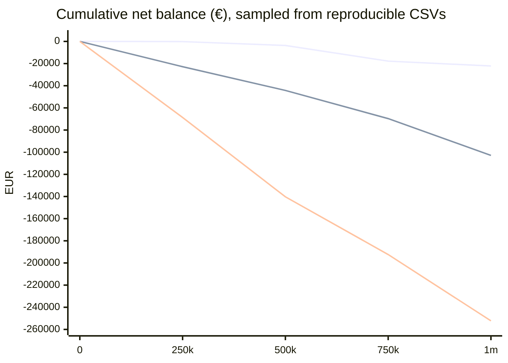

# V5.1 player economy simulation

Status: **simulated evidence; PASS for accounting/scaling at €1/€2/€5.** No math or production-code change. All runs use `SlotGame`, natural paid base rounds, real Chest selection, all subsequent features/extensions/dual flows, and the 5,000x cap.

## Three independent players — 1,000,000 paid rounds each

The engine was run at its exact €1 configuration; €2 and €5 displays are exact integer scaling of independent unit-stake engine outcomes. This is rigorous for these three stakes because every engine amount is an integer unit and €1/€2/€5 are respectively 5/10/25 cents per unit. No additional wager is made during physical free spins.

| player | stake | seeds engine/choice | physical FS | wagered | base paid | Scatter feature paid | Chest direct paid | total paid | net | RTP | max/min net | largest round | picks x1/x2/x5 | Max / accounting |
|---|---:|---|---:|---:|---:|---:|---:|---:|---:|---:|---:|---:|---|---|
| A | €1 | 2026110801 / 2026111801 | 94,928 | €1,000,000.00 | €574,223.80 | €355,746.70 | €47,859.05 | €977,829.55 | -€22,170.45 | 97.782955% | €2,265.10 / -€22,471.10 | €1,098.50 | 116/119/111 | 0 / 0 |
| B | €2 | 2026110802 / 2026111802 | 91,769 | €2,000,000.00 | €1,146,853.60 | €674,593.70 | €75,658.10 | €1,897,105.40 | -€102,894.60 | 94.855270% | €1,621.00 / -€102,894.60 | €1,464.50 | 95/115/83 | 0 / 0 |
| C | €5 | 2026110803 / 2026111803 | 93,237 | €5,000,000.00 | €2,866,726.25 | €1,682,099.75 | €198,934.75 | €4,747,760.75 | -€252,239.25 | 94.955215% | €228.75 / -€253,577.75 | €4,850.00 | 116/102/108 | 0 / 0 |

`Dual round paid` is deliberately not added: A/B/C respectively €22,858.45 / €33,438.70 / €86,705.25, and is a subset of the base + feature categories. Direct Chest excludes chest-selected segments appended to a Scatter feature, avoiding duplicate accounting.

## Cumulative balance graph data

CSV every 1,000 paid rounds, including start/end, is in `data/v5_1/player-economy/player-a.csv`, `player-b.csv`, `player-c.csv`. Selected checkpoints:

| rounds | A net | B net | C net |
|---:|---:|---:|---:|
| 0 | €0.00 | €0.00 | €0.00 |
| 250k | -€165.45 | -€22,822.40 | -€68,650.75 |
| 500k | -€3,654.10 | -€44,245.30 | -€140,265.75 |
| 750k | -€17,789.00 | -€69,677.80 | -€192,386.00 |
| 1m | -€22,170.45 | -€102,894.60 | -€252,239.25 |

## Twenty independent €1 sessions — 1m paid rounds each

Seeds are sequentially fixed, engine `2026110901..2026110920` and choice `2026111901..2026111920`; no seed was selected for RTP. Raw per-session JSON is in `data/v5_1/player-economy/session-*.json`.

| metric | result |
|---|---:|
| Median final net | -€39,618.40 |
| P5 / P25 / P75 / P95 final net | -€54,235.65 / -€43,585.70 / -€35,731.20 / -€29,925.65 |
| Worst / best final net | -€54,235.65 (session 16) / -€23,667.20 (session 14) |
| Mean RTP / session SD | 96.069418% / 0.680239 percentage points |
| RTP range | 94.576435%–97.633280% |
| Chest x5 selections | 2,144 total; mean 107.2/session, range 83–124 |
| Max Wins / accounting errors | 0 / 0 |

The large variance in terminal balances (a €30,568.45 gap between best and worst) is simulated, not evidence of a different RTP. Large single-round wins ranged materially by session; the largest observed was €2,598.35 (session 7). Chest x5 contributes a high-tail mechanism but this runner records its choice frequency separately; it does not assign an arbitrary causal share of all final-balance variation.

## Chest fairness and economy checks

Across the 20 sessions x1/x2/x5 selection counts are generated only from the shuffled one-each package and independent pick RNG; no stake enters the selection call. The three player samples show ordinary sampling variation, not a multiplier preference. No duplicate debit/credit or accounting failure was observed. The mean 20-session RTP, 96.069418%, is compatible with the bounded V5.1 capped theoretical interval 96.001501–96.001920% at the expected Monte Carlo sampling scale.

The observed individual player RTPs are not estimates precise enough to judge the target alone. They illustrate player-path risk: an expected 4% long-run loss remains highly variable after one million rounds.
